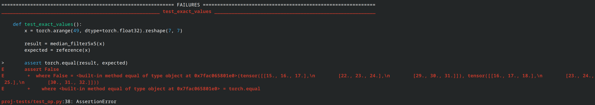
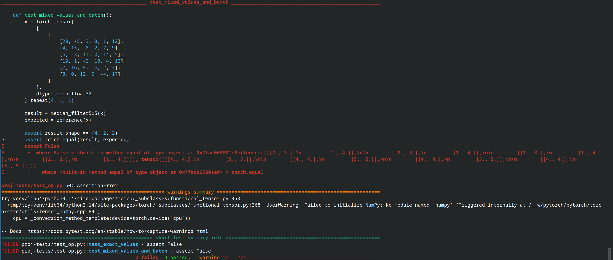

# median_filter5x5

For each image and each valid window position, return the median (the 13th
smallest value) of the 25 values in its 5×5 neighborhood. The filter uses
stride 1 and no padding. For a leading index tuple \(b\),

$y_{b,i,j}=\text{median}\{x_{b,i+u,j+v}:0\leq u,v<5\}.$

Exact one-line PyTorch reference:

```python
x.unfold(-2, 5, 1).unfold(-2, 5, 1).flatten(-2).median(dim=-1).values
```

Input: a strided CPU `float32` tensor of shape `(..., H, W)`, with `H >= 5`
and `W >= 5`. Any number of leading dimensions is supported, including no
leading dimensions and empty batch dimensions. Non-contiguous inputs are
accepted. Exact value agreement is supported for finite inputs.

Output: a CPU `float32` tensor of shape `(..., H-4, W-4)`, with every image
filtered independently.

## Docker bug

Basically during debugging, the wheel was installed with `/usr/bin/python3`,
while tests ran with Python from `/opt/venv`. The image built, but pytest
failed with `ModuleNotFoundError: No module named 'fse_ops'`. Using
`python3 -m pip` installs the wheel in the runtime venv. An import check
during the build now checks that the package is available there.

Fix commit: add later

## Testing Bug Detection

To verify that the tests can detect incorrect behavior, we intentionally introduced a bug in `src/fse_ops/ops.cpp` by modifying the following line:

**Correct version:**

```cpp
output_row[col] = window[12];
```

**Version with the bug:**

```cpp
output_row[col] = window[11];
```

A 5×5 window contains 25 elements, so the median corresponds to index 12 (using zero-based indexing). Using index 11 instead can produce incorrect results.

After rebuilding the C++ extension, I ran the tests using `pytest`. Two out of five tests failed:

- `test_exact_values`
- `test_mixed_values_and_batch`

**1. Result of test_exact_values**



**2. Result of test_mixed_values_and_batch**



### Analysis of the Results

The pytest output shows that only the tests checking numerical values failed, while the tests for output shape, data type, and error handling passed.

This suggests that the problem is likely related to the median calculation. Therefore, it makes sense to check how the median element is selected after calling `std::nth_element`.
